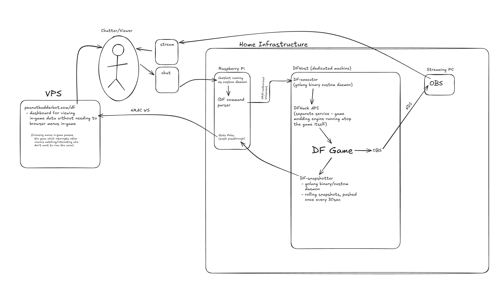

# nivek

A Go-based Twitch integration platform for live Dwarf Fortress streaming.

**nivek** lets Twitch chat interact with a running Dwarf Fortress game while automated snapshots feed a public web dashboard. The repository contains independent Go services, a Nuxt frontend, PostgreSQL persistence, EventSub integration, HMAC-authenticated machine-to-machine APIs, and an outbound snapshot pipeline.

## Architecture



- **`cmd/twitch-bot`** — Twitch IRC bot that joins active channels, validates chat input, and forwards supported commands.
- **`cmd/df-executor`** — Receives authenticated commands and executes them on the Dwarf Fortress host.
- **`cmd/df-snapshot-pusher`** — Reads atomic DFHack snapshots, validates and compresses them, signs the payload, and sends it outbound to Core API.
- **`cmd/core-api`** — Echo backend for Twitch sign-in, user features, snapshot ingestion, and dashboard APIs.
- **`nivek-nuxt`** — Nuxt 4 SSR frontend and public dashboard.

## Authentication

Twitch OAuth is the only user sign-in path. The local session is stored in an HttpOnly cookie, not in localStorage or a URL. Unsafe cookie-authenticated requests require a CSRF header. See [Authentication architecture](docs/AUTHENTICATION.md) for the complete flow and deployment requirements.

The production callback must be registered exactly as:

```text
https://peanutbudderbot.com/api/auth/twitch/callback
```

## Setup

```bash
cp .env.example .env
# Fill every required secret and Twitch application value.
docker compose up --build
```

Generate secrets rather than inventing memorable strings:

```bash
openssl rand -base64 48   # JWT secret
openssl rand -hex 32      # HMAC keys
```

### Optional bot settings

| Variable | Default | Purpose |
| --- | --- | --- |
| `TWITCH_BOT_ID` | `1322716097` | The bot's Twitch user id (peanutbudderbot). Used to ignore the bot's own chat messages, as the Helix send/moderator id, and as the `user_id` of `channel.chat.message` subscriptions. Only set it when running as a different bot account. |
| `TWITCH_BOT_NO_REPLY_LOGINS` | _(empty)_ | Extra comma-delimited Twitch logins the bot never replies to or runs commands for (case-insensitive, spaces trimmed). Added to the built-in list of well-known chat-bot accounts (`defaultNoReplyLogins` in `internal/libraries/twitchbot/const.go`), not a replacement for it. The bot's own login is always ignored. |

### `/api` prefix: local nginx vs prod Traefik

core-api serves every route under `/api` (`e.Group("/api")` in
`cmd/core-api/main.go`, e.g. `/api/healthz`), and the two proxies handle that
prefix differently:

- **Prod (Traefik, `docker-compose.yml`):** the `nivek` router matches
  `Host(peanutbudderbot.com) && PathPrefix(/api)` and forwards the path
  unchanged, so `/api/healthz` reaches core-api as `/api/healthz`. There is no
  strip-prefix middleware.
- **Local (`docker/nginx-local/default.conf`):** `location /api/` uses
  `proxy_pass http://core-api/;`. Because of the trailing `/`, nginx replaces
  the matched `/api/` with `/`, so `/api/healthz` reaches core-api as
  `/healthz`. Everything else (`location /`) goes to the `vue` upstream on
  `:5173`.

This config isn't referenced by `docker-compose.yml`. If you put it in front
of core-api, remember that it strips the prefix that core-api's routes expect.

## Validation

```bash
go test -race ./...
go vet ./...

cd nivek-nuxt
npm ci
npm run build
```

## Security properties

- OAuth state cookie with constant-time comparison and one-time deletion
- HttpOnly local session cookie plus double-submit CSRF defense
- HS256 allow-listing with issuer, audience, subject, JTI, time claims, and a minimum 32-byte signing secret
- Strict configuration validation before the HTTP server starts
- Narrow credentialed CORS policy derived from the frontend origin
- Request recovery, body limits, security headers, and HTTP server timeouts
- HMAC-authenticated internal APIs
- PostgreSQL isolated on an internal Docker network
- Read-only, capability-dropped application containers
- Pull-request CI for Go tests, race detection, vetting, formatting, and Nuxt production builds

See [SECURITY.md](SECURITY.md) for responsible disclosure and operational guidance.

## Logging

Code holding a `nivek.NivekService` logs through `svc.Logger()`; the standalone binaries and the libraries only they use log through the stdlib `log` package. Package-level `logrus.Errorf` is not used in core-api — it writes to a different logger instance than the one carrying the Discord alert hook. See [Logging conventions](docs/LOGGING.md).

**Stack:** Go, Echo, PostgreSQL, Nuxt, Twitch OAuth/Helix/EventSub, WebSockets, HMAC-SHA256, JWT, Docker, Traefik.
